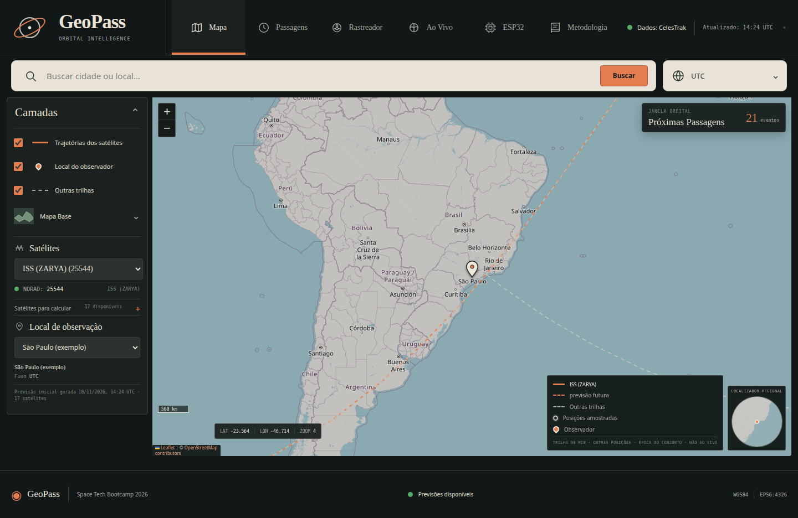
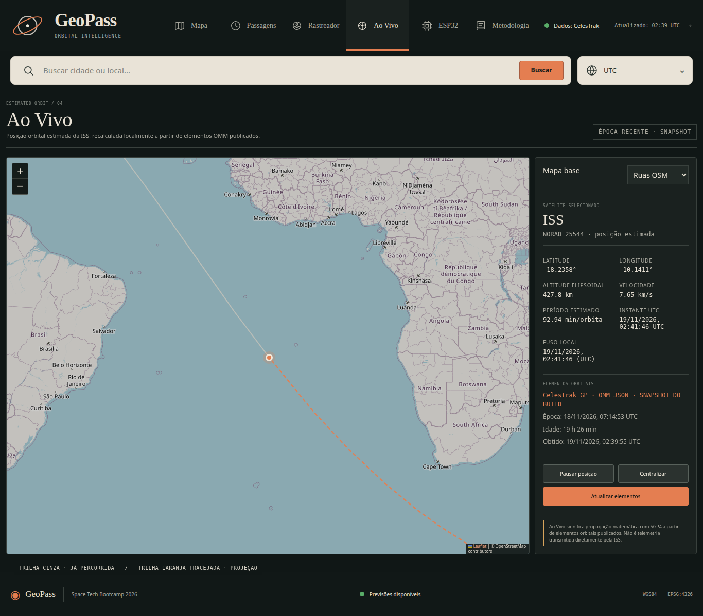

<p align="center">

</p> <h1 align="center">GeoPass</h1> <p align="center">
  WebGIS para prever, consultar e visualizar passagens de satélites sobre locais escolhidos.
</p>

## Sobre o Space Tech Bootcamp

O GeoPass é o projeto de capstone do **Future Tech Leaders Brasil 2026 — Space Tech Bootcamp**, iniciativa de capacitação online e gratuita em tecnologias espaciais realizada no Brasil pela Agência Espacial Brasileira (AEB), pelo Programa das Nações Unidas para o Desenvolvimento (PNUD) e pelo UNDP Istanbul International Center for Private Sector in Development (UNDP ICPSD). O projeto se relaciona principalmente ao eixo de dados geoespaciais do programa: combina uma localização na Terra com dados orbitais públicos e previsões temporais, apresentando o resultado em um mapa interativo.

## O problema que o GeoPass aborda

Elementos orbitais são publicados em formatos técnicos e nem sempre são simples de relacionar a uma pergunta prática: **quando um satélite passará sobre a minha cidade ou sobre um ponto específico?** O GeoPass busca tornar essa informação mais acessível ao combinar localização, tempo e propagação orbital em uma interface cartográfica.

O sistema usa elementos orbitais OMM da CelesTrak e o modelo SGP4 por meio do Skyfield. Para um observador escolhido, calcula eventos de subida, ponto de maior elevação e descida. A aplicação também apresenta elevação máxima, azimute e época dos elementos utilizados.

Uma passagem indicada pelo GeoPass é geométrica: o satélite ultrapassa o limite de elevação configurado. Isso não garante visibilidade a olho nu, pois iluminação do satélite, condições do céu e obstáculos locais também influenciam.

## Evolução do projeto

### Fase 1 — mapa e previsões iniciais

A primeira versão calcula previsões para localidades configuradas e grava os resultados em um conjunto de dados JSON. A interface Leaflet mostra localidades, trilhas terrestres, filtros e horários previstos. A suíte inicial cobre o agrupamento dos eventos orbitais.

### Fase 2 — busca geográfica e cálculo dinâmico

A segunda versão acrescenta um servidor Flask, busca manual de cidades com Nominatim e recálculo para coordenadas encontradas ou escolhidas por clique no mapa. Inclui escolha de fuso horário, sugestões regionais para o Brasil, cache de geocodificação e validações de entrada.

### Fase 3 — rastreador orbital simulado

A terceira versão acrescenta a visualização da trilha terrestre de um satélite selecionado. O usuário pode mover um marcador com um controle de tempo, reproduzir ou pausar a simulação, enquadrar a rota completa e retornar ao local do observador. O painel mostra o instante simulado em UTC e no fuso escolhido, além do subponto terrestre em latitude e longitude.

A trilha é calculada previamente a partir dos elementos orbitais disponíveis quando o dataset é gerado. **O rastreador não é ao vivo**: o marcador percorre pontos pré-calculados e não indica a posição atual do satélite.

### Fase 4 — integração serial local com ESP32

A quarta versão acrescenta uma ponte pySerial no servidor Flask local e um firmware PlatformIO para o ESP32. A pessoa seleciona uma passagem e uma porta; o computador envia uma mensagem `NEXT` com horários UTC e elevação máxima. O firmware valida os campos, imprime a passagem no Monitor Serial e responde com `ACK`.

A integração física é opcional. Os testes seriais simulam a comunicação e não substituem a validação com o hardware conectado.

### Fase 5 — Web Serial e preparação para Vercel

A quinta versão move a comunicação com a placa para a **Web Serial API no próprio navegador**. A pessoa autoriza a porta em uma ação explícita, envia o resumo da passagem e recebe o `ACK` sem exigir que o servidor hospedado acesse a USB do computador.

A fase também adiciona configuração para runtime Flask na Vercel, um script que gera a interface e os dados iniciais em `public/`, camadas cartográficas e uma interface responsiva.

### Fase 6 — visualização orbital e evolução cartográfica

A sexta versão integra o rastreamento orbital ao GeoPass existente, mantendo as funcionalidades das fases anteriores.

A Fase 6 inclui:

- nova vista **Ao Vivo** para a ISS, com propagação local SGP4 a partir de elementos OMM publicados;

- indicação da época, idade, origem e estado dos elementos orbitais;

- atualização manual dos elementos orbitais e fallback para snapshot de build;

- bloqueio de posição e trilha quando os elementos ultrapassam 72 horas de idade;

- separação visual entre rastro percorrido e previsão futura;

- componente compartilhado de trajetória para o Mapa e o Ao Vivo;

- normalização de longitude e tratamento da descontinuidade do antimeridiano;

- sincronização do marcador com a época do conjunto orbital;

- OpenStreetMap como camada inicial e Esri World Imagery como alternativa;

- mapa principal mais amplo, sidebar reduzida e painel de passagens recolhido;

- validação de payloads, cabeçalhos de segurança e mensagens de erro sem detalhes internos;

- configuração padrão de build, entrypoint Python e rewrite de APIs para Vercel.

A Fase 6 não utiliza uma aba de globo 3D separada. Todos os mapas permanecem mapas Leaflet padrão, mantendo consistência cartográfica e compatibilidade de implantação.

#### Imagens da Fase 6

<p align="center">

</p> <p align="center">
  
</p>

## Estrutura do repositório

```
README.md                         visão geral, bootcamp e evolução do projeto
RELATORIO_TESTES.txt              registros gerais de testes
fase1/                            mapa e previsões iniciais
fase2/                            busca geográfica e cálculo dinâmico
fase3/                            rastreador orbital simulado
fase4/                            integração serial local com ESP32/PlatformIO
fase5/                            Web Serial e preparação para build Vercel
fase6/                            visualização orbital e evolução cartográfica
```

Cada pasta contém seus arquivos, testes, dependências e README correspondente à respectiva etapa. Para executar a Fase 6, entre em `fase6/` e siga o [`fase6/README.md`](fase6/README.md).

## Tecnologias e fontes de dados

O projeto utiliza Python, Skyfield/SGP4 e Flask no backend, JavaScript e Leaflet na interface cartográfica e C++/Arduino com PlatformIO no firmware.

Os elementos orbitais vêm da [CelesTrak](https://celestrak.org/). A busca por cidades usa o [Nominatim](https://nominatim.org/) e deve respeitar sua [política de uso](https://operations.osmfoundation.org/policies/nominatim/). A interface oferece [OpenStreetMap](https://www.openstreetmap.org/) e [Esri World Imagery](https://www.arcgis.com/) como camadas cartográficas, com atribuições visíveis.

A Fase 6 utiliza também módulos locais do [satellite.js](https://github.com/shashwatak/satellite-js) para a propagação orbital no navegador. As licenças e atribuições dos componentes vendorizados devem ser mantidas ao redistribuir o projeto.

## Execução

Para executar a versão mais recente:

```bash
cd fase6
python3 -m venv .venv
. .venv/bin/activate
python -m pip install -r requirements.txt
python scripts/vercel_build.py
python server.py
```

Abra `http://127.0.0.1:8000/` no navegador.

Para atualizar o dataset orbital:

```bash
python scripts/build_dataset.py --refresh
```

## Testes e validação

Na Fase 6, os principais comandos são:

```bash
cd fase6
python -m unittest discover -s tests -p 'test_*.py' -q
node scripts/test_trajectory.mjs
node scripts/test_live_track.mjs
node scripts/test_live_freshness.mjs
python scripts/verify_live_parity.py
python scripts/vercel_build.py
```

A validação final executou 40 testes Python, testes de trajetória, antimeridiano, frescor dos elementos OMM, paridade satellite.js/Skyfield, build e smoke test do entrypoint Vercel. As seis abas — Mapa, Passagens, Rastreador, Ao Vivo, ESP32 e Metodologia — foram percorridas em Chromium. As camadas OpenStreetMap e Esri foram verificadas no Mapa e no Ao Vivo.

Consulte o [relatório de auditoria da Fase 6](fase6/RELATORIO_AUDITORIA_FASE6.md) para os resultados detalhados.

## Implantação na Vercel

A pasta `fase6/` contém:

- `vercel.json`, com comando de build, saída `public/`, runtime Python 3.12 e rewrite de `/api/*`;

- `api/index.py`, que exporta `server.app`;

- `scripts/vercel_build.py`, que gera o dataset e a saída estática;

- snapshot local para contingência quando uma fonte externa não estiver disponível.

A estrutura foi validada localmente em uma cópia limpa, incluindo instalação das dependências, build, importação do entrypoint e smoke test de `/` e `/api/live/omm`. A publicação remota ainda precisa ser executada e validada na conta Vercel do responsável.

## Limites do protótipo

- CelesTrak, Nominatim, OpenStreetMap e Esri são serviços externos e podem sofrer indisponibilidade, rate limit ou mudanças de política.

- A posição Ao Vivo é uma estimativa SGP4 baseada na época e na qualidade dos elementos OMM; não é telemetria.

- As passagens são geométricas e não modelam nuvens, iluminação, obstáculos locais ou magnitude aparente.

- O Rastreador percorre uma trilha pré-calculada e não deve ser confundido com a vista Ao Vivo.

- A comunicação física com ESP32 depende de hardware compatível, permissões e navegador com Web Serial.

- A publicação remota precisa ser executada e validada na conta de implantação.

## Documentação da Fase 6

- [README da Fase 6](fase6/README.md)

- [Auditoria final](fase6/RELATORIO_AUDITORIA_FASE6.md)

- [Auditoria cartográfica](fase6/RELATORIO_CARTOGRAFIA.md)

- [Reconstrução das trajetórias](fase6/RELATORIO_TRAJETORIAS.md)

## Autor

**Luiz Gustavo de Barros e Silva Santos**
Future Tech Leaders Brasil — Space Tech Bootcamp 2026.
