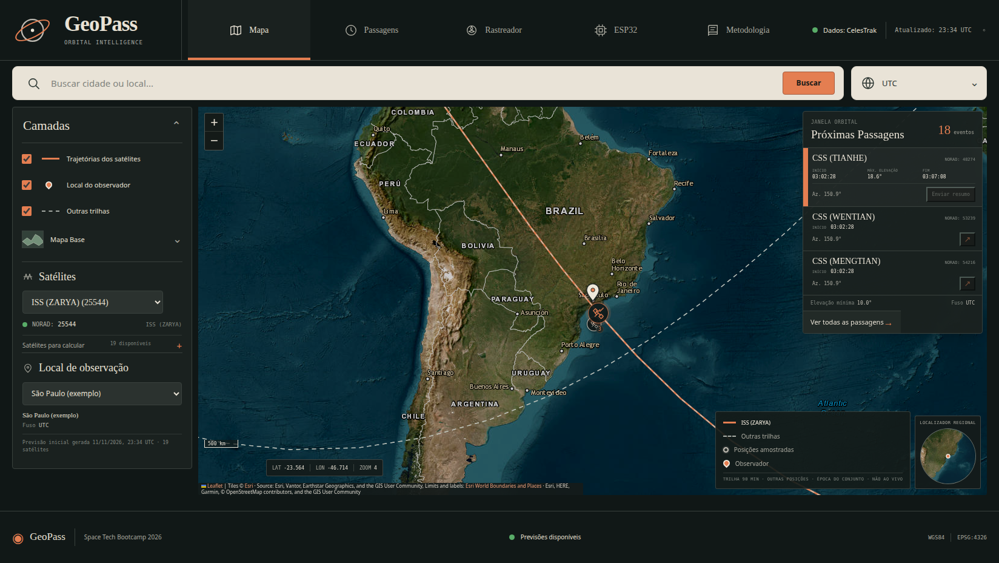

# GeoPass — Fase 5: Web Serial e preparação para Vercel

## Sobre o Space Tech Bootcamp

O GeoPass é o projeto de capstone do **Future Tech Leaders Brasil 2026 — Space Tech Bootcamp**, iniciativa de capacitação online e gratuita em tecnologias espaciais realizada no Brasil pela Agência Espacial Brasileira (AEB), pelo PNUD, pelo UNDP ICPSD e pelo SDG AI Lab. O [e-book oficial do programa](https://github.com/ftl-brazil-2026/ebook) reúne conteúdos de GIS e sensoriamento remoto, Machine Learning, Deep Learning e aplicações espaciais. A [apresentação da AEB](https://www.gov.br/aeb/pt-br/assuntos/noticias/inscricoes-abertas-para-o-bootcamp-de-tecnologias-espaciais-do-future-tech-leaders-programme) traz informações institucionais sobre a formação.

## O que esta fase acrescenta

A Fase 5 mantém a busca geográfica, os cálculos de passagens e a simulação da trilha terrestre. A integração opcional com o ESP32 passa a usar **Web Serial API diretamente no navegador**: após um clique da pessoa e a autorização da porta, o navegador envia um resumo da passagem e aguarda o `ACK` do firmware. A comunicação USB não depende de o servidor na nuvem ter acesso à porta serial do computador.

Esta fase também acrescenta uma preparação de build para Vercel. O script `scripts/vercel_build.py` baixa os elementos orbitais e gera a página, os assets CSS/JavaScript, o manifesto de páginas e os dados iniciais em `public/`. O servidor Flask atende as rotas dinâmicas e serve a prévia local. O projeto inclui configuração de runtime Python e de entrypoint, mas **não está publicado**: o deploy ainda precisa ser iniciado na conta Vercel do autor.

## Prévia de redesign

Esta cópia de trabalho apresenta o redesign **Scientific Atlas**, baseado na referência escura enviada pelo autor. Consulte o [plano visual aprovado](plan.md), a [referência recebida](artifacts/reference/GeoPass-Atlas-Referencia.png) e o [relatório da prévia](RELATORIO_PREVIA.md). Capturas: [Mapa — desktop](artifacts/screenshots/GeoPass-Desktop.png), [Passagens](artifacts/screenshots/GeoPass-Passagens.png), [Rastreador](artifacts/screenshots/GeoPass-Tracker.png), [ESP32](artifacts/screenshots/GeoPass-ESP32.png), [Metodologia](artifacts/screenshots/GeoPass-Metodologia.png), [tablet](artifacts/screenshots/GeoPass-Tablet.png) e [celular](artifacts/screenshots/GeoPass-Mobile.png).



A camada JavaScript foi reorganizada para apresentar as cinco vistas, camadas cartográficas, posições já amostradas e detalhes tabulares; os cálculos orbitais, APIs de negócio, série temporal e controles da simulação do rastreador, protocolo Web Serial/ACK, firmware e configuração Vercel foram preservados. Os marcadores representam dados pré-calculados, não posições ao vivo. A suíte local teve **25 testes aprovados** e o build gerou 19 satélites, 153 passagens e 3 localidades. Ainda não houve preview remoto/deploy Vercel nem novo ensaio físico do ESP32. Consulte o [registro final de validação](artifacts/validation-final.txt) e o [checklist Vercel](VERCEL_TESTE.md).

## Executar localmente no Windows PowerShell

Extraia o repositório, entre na pasta `fase5` e troque o caminho de exemplo pelo local onde o projeto foi extraído:

```powershell
Set-Location -LiteralPath "C:\caminho\para\GeoPass\fase5"
py --version
py -m venv .venv
.\.venv\Scripts\python.exe -m pip install -r requirements.txt
```

Rode os testes e gere o conjunto inicial de dados orbitais:

```powershell
.\.venv\Scripts\python.exe -m unittest discover -s tests -v
.\.venv\Scripts\python.exe scripts\build_dataset.py
```

Inicie o servidor local:

```powershell
.\.venv\Scripts\python.exe server.py
```

Mantenha o terminal aberto e acesse <http://127.0.0.1:8000/>. A aplicação precisa de internet para consultar dados orbitais e cidades.

## Conectar o ESP32 pelo navegador

1. Use Chrome ou Edge atualizado em `localhost` ou em uma página HTTPS.
2. Feche o Monitor Serial da Arduino IDE/PlatformIO para liberar a porta.
3. Clique em **Conectar ESP32** e selecione a porta na janela de permissão do navegador.
4. Escolha uma passagem e clique em **Enviar resumo ao ESP32**.
5. Confira a resposta `ACK|1|<NORAD>|OK` na interface.

A conexão é iniciada por ação explícita da pessoa; a página não varre nem lê silenciosamente as portas USB. Se Web Serial não estiver disponível, ou se a pessoa não autorizar a conexão, mapa e previsões continuam funcionando.

Nos ensaios físicos anteriores ao redesign Atlas, o firmware foi carregado e testado em uma placa ESP32-WROOM-32D DevKitC; os registros mostram `READY|GEOPASS1` e confirmação pela COM3 com `ACK|1|25544|OK`. Essa verificação é histórica e não foi repetida nesta rodada visual. A suíte atual possui **25 testes automatizados**; os testes de serial simulam a comunicação e não substituem o ensaio físico.

## Build de assets do Vercel

Com as dependências instaladas e acesso à internet, execute:

```powershell
.\.venv\Scripts\python.exe scripts\vercel_build.py
```

O comando gera `public/index.html`, `public/assets/app.css`, `public/assets/app.js`, `public/manus-routes.json` e `public/data/passes.json`; a pasta `public/` é saída de build e está ignorada pelo Git. O build foi testado em ambiente limpo com `uv`, instalando as dependências declaradas no `pyproject.toml`; isso não é uma publicação no Vercel.

Para configurar o primeiro deploy, importe o repositório no Vercel e defina `fase5` como **Root Directory**. O `pyproject.toml` declara as dependências, Python 3.12, o entrypoint Flask `server:app` e o comando de build `python scripts/vercel_build.py`. Confira o log do primeiro build e procure a mensagem `Vercel build OK`. Não há URL de produção incluída nesta entrega.

Após receber uma URL de preview, siga o checklist desta cópia: [VERCEL_TESTE.md](VERCEL_TESTE.md).

As funções na nuvem não podem acessar a USB/COM do computador. Por isso, as rotas legadas de pySerial retornam uma mensagem explicativa no runtime Vercel; a conexão com a placa é feita no próprio navegador pela Web Serial API. O runtime tem filesystem efêmero/somente leitura para esse uso: os dados iniciais são produzidos no build, e caches de execução podem não persistir.

## Limites do protótipo

- A passagem calculada é geométrica e não garante visibilidade a olho nu.
- A trilha no mapa é uma simulação pré-calculada, não rastreamento em tempo real.
- O firmware confirma e imprime o resumo serial; esta fase ainda não aciona OLED, LED, buzzer ou outros periféricos.
- A busca usa o serviço público Nominatim; consulte sua [política de uso](https://operations.osmfoundation.org/policies/nominatim/) antes de divulgar amplamente.
- A preparação de build Vercel foi validada localmente; o deploy remoto ainda precisa ser iniciado e conferido.

## Estrutura da Fase 5

```text
server.py                   Flask: interface/API dinâmica e rotas locais
web/index.html              estrutura semântica da interface
web/assets/app.css          identidade visual e layout responsivo
web/assets/app.js           interações do mapa, passagens, rastreador e Web Serial
web/manus-routes.json       manifesto das páginas da prévia
scripts/build_dataset.py    OMM, SGP4, passagens e trilhas
scripts/vercel_build.py     geração dos assets estáticos para deploy
scripts/esp32_serial.py     protocolo NEXT/ACK e compatibilidade serial local
esp32/platformio.ini        ambiente PlatformIO
esp32/src/main.cpp          firmware PlatformIO
esp32/geopass_receiver.ino  firmware alternativo para Arduino IDE
pyproject.toml              entrypoint Flask e build Vercel
.python-version             versão Python do runtime de deploy
requirements.txt            dependências Python
tests/                      testes de API, cálculo, serial e filesystem
```

## Autor

**Luiz Gustavo de Barros e Silva Santos**  
Future Tech Leaders Brasil — Space Tech Bootcamp 2026.
