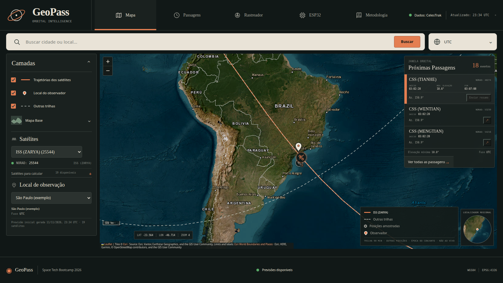

# GeoPass — relatório da prévia Scientific Atlas

**Data:** 11 de novembro de 2026. **Status:** redesign funcional implementado, validado localmente e incluído no pacote consolidado das cinco fases entregue junto a esta prévia. Não houve preview remoto Vercel, deploy de produção nem publicação/sincronização direta no GitHub do autor.

## A. Pesquisa e referências visuais

A direção visual vigente é **Scientific Atlas**, baseada na referência escura fornecida pelo autor. Foram consideradas as referências abaixo para organização de mapas, camadas, tempo e metadados; nenhuma interface foi copiada. A seleção cartográfica e as condições dos provedores estão documentadas em [artifacts/research-map-layer.md](artifacts/research-map-layer.md).

- [NASA Worldview](https://www.earthdata.nasa.gov/data/tools/worldview): exploração cartográfica e temporal.
- [Copernicus Browser](https://documentation.dataspace.copernicus.eu/Applications/Browser.html): relação entre canvas, camadas e controles.
- [QGIS](https://docs.qgis.org/latest/en/docs/user_manual/introduction/qgis_gui.html): organização de canvas, painéis e coordenadas em GIS profissional.
- [NASA Eyes](https://science.nasa.gov/eyes/): comunicação de contexto orbital e tempo, sem incorporar um globo 3D ao GeoPass.

A proposta vigente está em [plan.md](plan.md); a [referência recebida](artifacts/reference/GeoPass-Atlas-Referencia.png) e a pesquisa cartográfica ficam registradas no repositório. O rascunho `artifacts/proposta-direcao-visual-v2.md` descreve uma direção anterior e não é o plano atual.

## B. Diagnóstico da arquitetura

A prévia parte da Fase 5 em uma cópia separada. O projeto combina Flask, Skyfield/SGP4, Leaflet, OpenStreetMap, dados JSON, Nominatim e Web Serial. No workspace atual, a interface já está dividida em `web/index.html`, `web/assets/app.css` e `web/assets/app.js`; o arquivo JavaScript concentra as interações de consulta, mapa, rastreador e conexão serial.

O apoio Vercel aceito anteriormente já está presente: runtime/entrypoint Flask, script `scripts/vercel_build.py`, saída estática `public/` e manifesto `web/manus-routes.json`. A geração do build local funciona sem usar filesystem como armazenamento persistente. A URL canônica de tiles OpenStreetMap e a atribuição foram preservadas.

A comunicação ESP32 é iniciada pelo navegador, com autorização do usuário; a função hospedada não acessa USB/COM. A trilha orbital continua sendo simulação com pontos previamente calculados, não rastreamento ao vivo.

## C. Direção visual implementada

O **Scientific Atlas** substitui o tema anterior por carvão e grafite (`#101716`, `#1A211F`, `#222A27`), bordas discretas, texto marfim (`#E9E2D5`), acento orbital laranja (`#E47E51`) e verde reservado a estados operacionais. Títulos serifados, controles sans-serif de sistema e dados técnicos monoespaçados definem a hierarquia. Não foram adicionadas fontes remotas ou dependências.

A composição usa masthead e navegação indexada, busca, mapa protagonista, controles/legenda e painel de passagens. As cinco vistas — Mapa, Passagens, Rastreador, ESP32 e Metodologia — têm navegação por fragmento de URL. Em tablets e celulares, os controles laterais tornam-se recolhíveis para preservar espaço cartográfico e leitura.

## D. Implementação

`web/index.html` foi reorganizado para as cinco vistas e manteve os IDs funcionais. `web/assets/app.css` implementa tokens, geometria, breakpoints, controles Leaflet, foco e painéis recolhíveis. `web/assets/app.js` foi alterado apenas na camada de apresentação para navegação, camadas cartográficas, painéis, marcadores e tabelas usando dados e amostras existentes. A vista Mapa pode mostrar uma janela de 90 minutos e destacar um ponto já amostrado da próxima passagem; isso não calcula nem comunica posição ao vivo. O Rastreador mantém sua série completa e reprodução temporal.

`tests/test_api.py` teve a asserção de aparência/camadas atualizada. A comparação do working tree com a base confirmou sem alterações os arquivos funcionais/deploy auditados: `server.py`, scripts orbitais, build e serial, configuração Vercel, manifesto, dependências e firmware. Nenhum endpoint, cálculo, dataset versionado, payload, contrato Web Serial/ACK ou protocolo foi mudado.

## E. Comparação antes/depois e capturas

**Antes:** tema escuro anterior, com acentos ciano e componentes de dashboard. **Depois:** identidade Scientific Atlas em carvão/grafite, texto marfim, acento laranja orbital, mapa ampliado e painel operacional integrado, conforme a referência recebida.

| Vista / dispositivo | Captura |
| --- | --- |
| Passagens — desktop | [GeoPass-Passagens.png](artifacts/screenshots/GeoPass-Passagens.png) |
| Rastreador — desktop | [GeoPass-Tracker.png](artifacts/screenshots/GeoPass-Tracker.png) |
| ESP32 — desktop | [GeoPass-ESP32.png](artifacts/screenshots/GeoPass-ESP32.png) |
| Metodologia — desktop | [GeoPass-Metodologia.png](artifacts/screenshots/GeoPass-Metodologia.png) |
| Mapa — tablet, 768 × 1304 | [GeoPass-Tablet.png](artifacts/screenshots/GeoPass-Tablet.png) |
| Mapa — celular, 390 × 1074 | [GeoPass-Mobile.png](artifacts/screenshots/GeoPass-Mobile.png) |

As capturas demonstram as cinco vistas e a composição responsiva. A navegação e os controles cartográficos também foram verificados na prévia local; as imagens não substituem um ensaio físico serial.

## F. Arquivos modificados nesta rodada

| Arquivo | Alteração |
| --- | --- |
| `web/index.html` | Estrutura, navegação e cinco vistas Scientific Atlas. |
| `web/assets/app.css` | Identidade escura, cartografia, controles e breakpoints responsivos. |
| `web/assets/app.js` | Apresentação de vistas/camadas/tabelas usando funções e dados de negócio existentes. |
| `tests/test_api.py` | Asserções visuais atualizadas; regras de negócio preservadas. |
| `README.md`, `plan.md`, `TODO.md`, `VERCEL_TESTE.md` | Identidade, plano, status e instruções de validação atualizados. |
| `RELATORIO_PREVIA.md` | Este relatório. |
| `artifacts/validation-final.txt` | Registro de testes/build/checagens locais. |
| `artifacts/research-map-layer.md` | Fontes e limitações de tiles/overlays. |
| `artifacts/screenshots/*.png` | Sete capturas finais listadas acima. |

Os arquivos de suporte Vercel, cálculos, dados orbitais versionados, firmware e manifesto permaneceram sem mudanças. `app.js` foi modificado apenas para a apresentação conforme descrito acima.

## G. Arquivos novos e dependências

Foram adicionados a referência recebida em `artifacts/reference/`, a pesquisa cartográfica, capturas atualizadas e o registro de validação. Não foram adicionadas APIs, dependências runtime, endpoints ou serviços.

## H. Testes e validação

A suíte completa passou: **25 testes** cobrindo API, consulta dinâmica, regras de fuso e seleção, núcleo orbital, protocolo/ACK serial e build/filesystem Vercel. Também passaram `node --check web/assets/app.js` e `python -m compileall -q server.py scripts tests`.

O teste estrutural encontrou os **74/74 IDs** referenciados pelo JavaScript no DOM. Após o build, página, CSS, JavaScript e manifesto em `public/` foram comparados às fontes; os arquivos coincidiram. No Flask ativo da prévia, `/`, `/manus-routes.json`, `/assets/app.css`, `/assets/app.js` e `/data/passes.json` responderam HTTP 200. As cinco vistas e a alternância de trilhas/OSM/Esri foram verificadas no navegador; a atribuição cartográfica acompanhou a base escolhida. O registro integral está em [artifacts/validation-final.txt](artifacts/validation-final.txt).

Os testes seriais automatizados usam comunicação simulada. O hardware físico não foi reconectado durante esta rodada; não se deve interpretar os testes como novo ensaio de cabo/placa.

## I. Build de produção local

`python scripts/vercel_build.py` concluiu com `Vercel build OK: 19 satélites, 153 passagens, 3 localidades` no snapshot de `2026-11-11T23:34:09Z`, executado também na cópia consolidada final. Esses totais mudam com a época e os elementos orbitais. A página, assets, manifesto e dados foram servidos localmente e comparados às fontes.

## J. Compatibilidade com Vercel e limitações

O que foi validado é o build local e a prévia Flask/WebDev; **não houve preview remoto nem deploy na conta Vercel**, portanto a publicação remota ainda não está comprovada. Ao levar a versão à estrutura consolidada, mantenha `fase5` como Root Directory conforme o checklist [VERCEL_TESTE.md](VERCEL_TESTE.md). Nenhum deploy de produção foi feito.

A Vercel não pode acessar a porta USB do computador. Web Serial continua no navegador, em contexto seguro (HTTPS ou localhost), com autorização explícita. O filesystem serverless é efêmero; nenhum estado local persistente foi introduzido. A cartografia usa Esri World Imagery/World Boundaries and Places e OSM como alternativa, com atribuição visível e sem endpoint/cartografia no backend. O overlay Esri de limites está em retirada; os provedores são best-effort e sujeitos a termos próprios — consulte a pesquisa cartográfica.

## K. Como visualizar

No workspace Manus, abra a aba **Preview** deste projeto para navegar pela versão atual (porta 3000). Na cópia extraída do repositório, siga os comandos de Windows PowerShell do [README.md](README.md), dentro da pasta `fase5`; o Flask local atende em `http://127.0.0.1:8000/`. A prévia do workspace não é necessária para executar a cópia local.

## L. Próximas validações

Antes da apresentação, vale fazer um ensaio físico novamente no Chrome/Edge: fechar o Monitor Serial, autorizar a porta no navegador e conferir um `ACK` real. Após revisar o pacote, o autor pode extraí-lo/enviá-lo ao GitHub e, com acesso à própria conta Vercel, executar o checklist de preview remoto — sem confundir build local com deploy validado.

## Referências

- [NASA Worldview](https://www.earthdata.nasa.gov/data/tools/worldview)
- [Copernicus Browser](https://documentation.dataspace.copernicus.eu/Applications/Browser.html)
- [QGIS User Guide — GUI](https://docs.qgis.org/latest/en/docs/user_manual/introduction/qgis_gui.html)
- [NASA Eyes](https://science.nasa.gov/eyes/)
- [Vercel Python Runtime](https://vercel.com/docs/functions/runtimes/python)
- [MDN — Web Serial API](https://developer.mozilla.org/en-US/docs/Web/API/Web_Serial_API)
